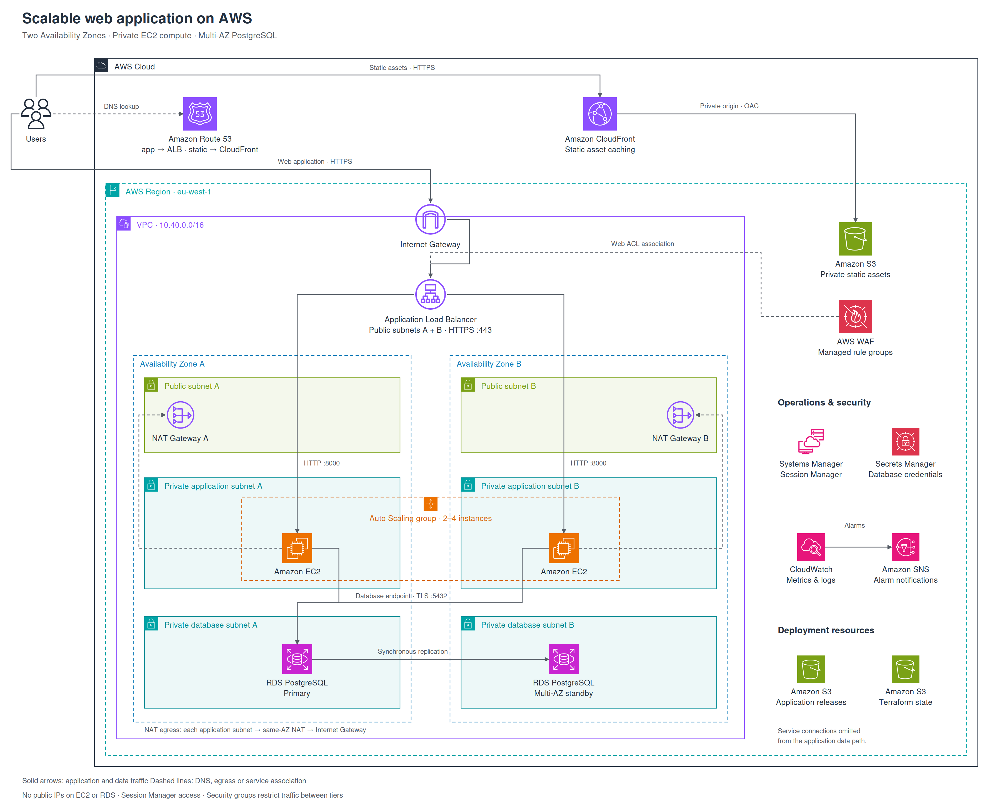

# Scalable Web Application on AWS

A small Flask application running on private EC2 instances across two Availability Zones. An ALB handles incoming traffic, Auto Scaling manages capacity, and RDS PostgreSQL stores the data.

## Architecture



CloudFront serves static assets from S3. WAF protects application requests, Session Manager provides instance access, and CloudWatch sends alerts through SNS.

## Setup

You need an AWS account, a public Route 53 hosted zone, Terraform 1.11+ and the AWS CLI. The application code is ready; AWS deployment and live testing are still pending.

<details>
<summary>Deployment steps</summary>

1. Authenticate to AWS and confirm the account with `aws sts get-caller-identity`.
2. Create the state bucket, using your own unique name:

```bash
terraform -chdir=infra/bootstrap init
terraform -chdir=infra/bootstrap apply -var='aws_region=eu-west-1' -var='state_bucket_name=YOUR-UNIQUE-BUCKET'
```

3. Copy the example configuration files and enter your Region, domain, hosted-zone ID, alert email and state bucket:

```bash
cp infra/terraform.tfvars.example infra/terraform.tfvars
cp infra/backend.hcl.example infra/backend.hcl
terraform -chdir=infra init -backend-config=backend.hcl
terraform -chdir=infra plan -out=deployment.tfplan
terraform -chdir=infra apply deployment.tfplan
```

4. Connect to one application instance through Session Manager. Once the application is installed, initialize the database:

```bash
sudo bash
set -a
source /etc/webapp.env
set +a
cd /opt/webapp
/opt/webapp/.venv/bin/python init_db.py
exit
```

5. Set `enable_db_bootstrap = false` in your tfvars and apply again to remove temporary administrator-secret access.
6. Run `terraform -chdir=infra output`. Open the application URL, retrieve the demo login from the secret identified by `app_secret_arn`, and confirm the SNS email subscription.

AWS resources incur charges. Keep credentials, plans and state out of Git. The shared demo login is for this exercise; replace it before production use.

</details>

<details>
<summary>Cleanup</summary>

Set `deletion_protection = false` and apply. Empty all versions in the two application S3 buckets, then review and apply a Terraform destroy plan. Keep the state bucket secure. RDS creates a final snapshot; retained snapshots still incur charges.

</details>

## Files

- `app/` — application code
- `infra/` — Terraform configuration
- `tests/` — application tests
- `.github/workflows/` — automated validation

## Tests

In a Python virtual environment, install `app/requirements.txt` and `tests/requirements.txt`, then run `python -m pytest -q tests`. GitHub Actions also checks Terraform formatting and validation.

## References

[AWS VPC example](https://docs.aws.amazon.com/vpc/latest/userguide/vpc-example-private-subnets-nat.html) · [RDS Multi-AZ](https://docs.aws.amazon.com/AmazonRDS/latest/UserGuide/Concepts.MultiAZSingleStandby.html)

Code: [MIT License](LICENSE). The diagram contains [AWS architecture icons](https://aws.amazon.com/architecture/icons/), which retain their original terms and are not covered by the code license.
